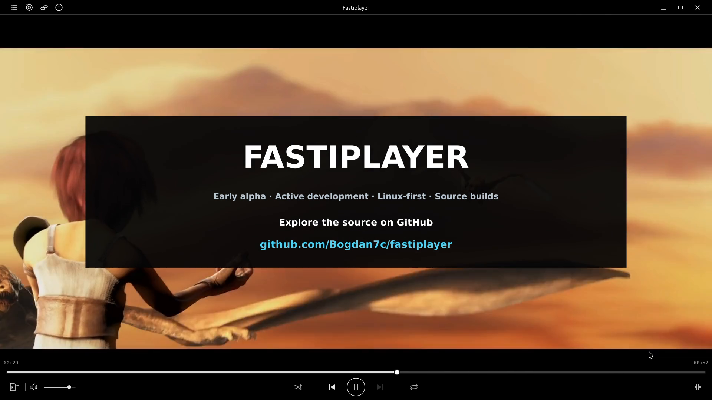
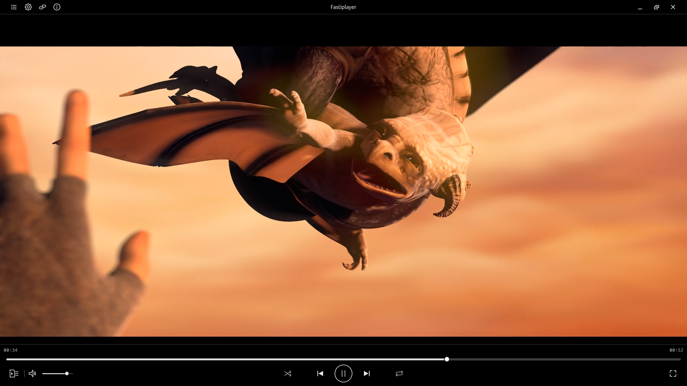
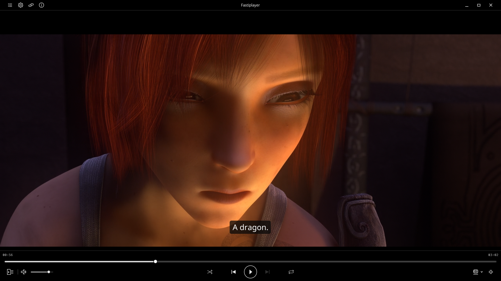
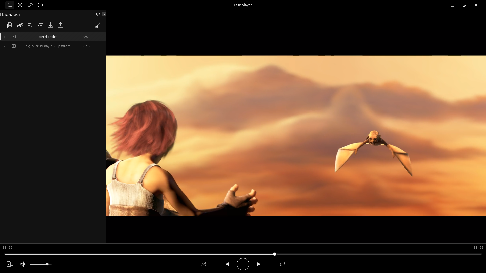

<p align="center">
  
</p>

<h1 align="center">Fastiplayer</h1>

<p align="center">
  <b>A fast, good-looking media player for Linux, written in Rust.</b><br>
  Scrub through video like in an editor. Speed it up without chipmunk voices. Tune the picture while it plays.
</p>

<p align="center">
  <a href="https://www.youtube.com/watch?v=eMfzBhpSF8M"><b>▶ Watch the 72-second trailer</b></a> ·
  <a href="#try-it">Try it</a> ·
  <a href="#roadmap-to-10">Roadmap</a> ·
  <a href="docs/vision.md">Vision</a>
</p>

<p align="center">
  <a href="https://github.com/Bogdan7c/fastiplayer/actions/workflows/ci.yml"></a>
  <a href="https://github.com/Bogdan7c/fastiplayer/actions/workflows/toolchain-policy.yml"></a>
  <a href="LICENSE"></a>
</p>

[](https://www.youtube.com/watch?v=eMfzBhpSF8M)

<sub>Real application footage, 1080p60 with the player's own sound. Film: <i>Sintel</i> © copyright Blender Foundation, CC BY 3.0 · <a href="docs/demo.md">timecodes and screenshots</a> · <a href="docs/assets/README.md">capture details</a></sub>

> **Early alpha.** Fastiplayer already plays local files and network streams every day, but it is young: Linux only, built from source, and parts of the interface are still in Russian. If you like trying things early and telling the author what breaks, you are exactly who it is for.

## Why Fastiplayer

<p align="center">
  
</p>

**Scrubbing that feels like an editor.** Grab the timeline and drag in either direction: the main picture follows your hand, not a tiny thumbnail. Let go and playback continues from there.

**Speed without chipmunks.** Go from 1.0× to 1.5× and back: voices keep their pitch, and the change is instant.

**Live picture controls.** Brightness, contrast, saturation, and per-channel color change on the running video, with instant preview and one-click reset.

**Hardware-accelerated and light on memory.** VA-API decoding on supported GPUs, Vulkan rendering through WGPU, and GPU HDR-to-SDR tone mapping. In a recorded test, Fastiplayer held under 90 MiB of RAM on 1080p60 and 4K60, where VLC used 127–300 MiB ([details](#performance)).

**Plays what you throw at it.** Drop files, folders, playlists, or links into the window. Local media, HTTP(S)/FTP(S), HLS and DASH (VOD, live, and DVR), internet radio, and — with optional `yt-dlp` — web pages.

**Subtitles that just work, and look right.** Fastiplayer has its own subtitle engine, written from scratch in Rust and drawn on the GPU.
- **Formats:** SRT and WebVTT; styled ASS/SSA rendered to match libass, with karaoke, animations, rotations and fonts packed into the MKV; Blu-ray PGS pictures.
- **YouTube:** manual captions, automatic captions and auto-translations, plus dubbed audio languages.
- **Streams:** subtitle tracks inside HLS and DASH.
- **Your files:** subtitles next to the video are found automatically, and you can drop a file onto the window.
- **Control:** press `C` to toggle them, `Z`/`X` to fix the sync, and drag them where you like right on the video.

Fastiplayer remembers your choice for every video.

<p align="center">
  <br>
  <sub>Film: <i>Sintel</i> © copyright Blender Foundation, CC BY 3.0 · <a href="docs/subtitles/compatibility.md">subtitle compatibility matrix</a> · <a href="docs/subtitles/user-guide.md">subtitle guide</a></sub>
</p>

**A queue that remembers.** M3U/M3U8, XSPF, and CUE playlists, import and export, and playback resumes where you stopped.

## What works today

<p align="center">
  <br>
  <sub>Films: <i>Sintel</i> and <i>Big Buck Bunny</i> © copyright Blender Foundation, CC BY 3.0 · <a href="docs/assets/README.md#2026-10-11-screenshots">capture details</a></sub>
</p>

- **Playback:** local video and audio, seeking, audio/video stream selection, pitch-preserving speed, live scrubbing.
- **Hardware decoding:** VA-API where the GPU and driver support it, FFmpeg software decoding otherwise; WGPU/Vulkan rendering; HDR-to-SDR tone mapping, including AV1 10-bit.
- **Network:** progressive HTTP(S)/FTP(S), HLS and DASH VOD/live/DVR, audio-only HLS radio, static Smooth Streaming and HDS; web pages through optional system `yt-dlp`.
- **Subtitles:** a native Rust engine with its own GPU pass. It plays SRT, WebVTT, ASS/SSA (libass-parity rendering, fonts attached to MKV), PGS and MP4 `mov_text`, YouTube manual and automatic captions, and HLS/DASH text tracks. Files next to the video are found automatically, and you can drop a file onto the window. A CC button, hotkeys and on-video appearance editing are included, and track and delay choices are remembered per video. See the [subtitle matrix](docs/subtitles/compatibility.md) and [user guide](docs/subtitles/user-guide.md).
- **Drag-and-drop and "Open with":** drop on the panel to append to the queue, drop on the video to start a new queue; opening a file while the player runs hands it to the existing window.
- **Queue:** playlist import/export (including legacy Windows-1251 `.m3u`/`.cue`), position restore, broken items skipped with a clear reason.
- **Control:** mouse-wheel and arrow-key volume, speed hotkeys, Ctrl+O, timeline time hints; volume and mute are remembered.
- **Runtime settings** with live preview and Apply/rollback.

Exact supported containers, codecs, and protocols are listed in the [compatibility matrix](docs/web-media-compatibility-matrix.md). Subtitle formats and sources have their own [subtitle compatibility matrix](docs/subtitles/compatibility.md).

## Try it

You need Linux x86_64, a GPU with a working Vulkan driver, and [rustup](https://rustup.rs) — the repository pins Rust **1.99.0** in [rust-toolchain.toml](rust-toolchain.toml).

**Arch Linux / CachyOS / Manjaro**

```bash
sudo pacman -S --needed base-devel git clang pkgconf curl meson nasm alsa-lib libdrm mesa libva vulkan-icd-loader rustup
```

**Ubuntu 24.04 / Debian-based**

```bash
sudo apt-get update
sudo apt-get install build-essential git clang libclang-dev pkg-config \
  curl meson nasm ninja-build \
  libasound2-dev libdrm-dev libgbm-dev libva-dev \
  libvulkan1 mesa-vulkan-drivers
```

**Fedora / RHEL-based**

```bash
sudo dnf install gcc gcc-c++ make git clang clang-devel pkgconf-pkg-config \
  curl meson nasm ninja-build \
  alsa-lib-devel libdrm-devel mesa-libgbm-devel libva-devel \
  vulkan-loader mesa-vulkan-drivers rustup
rustup-init   # Fedora ships rustup as a package; this installs the toolchain manager
```

**Build and play**

```bash
git clone https://github.com/Bogdan7c/fastiplayer.git
cd fastiplayer
cargo build -p app-egui --release --locked
./target/release/fastiplayer /path/to/video.mp4
```

The software decoder does not depend on the FFmpeg installed on your system. The first build downloads FFmpeg 8.1.3 and dav1d 1.5.4, checks them against pinned SHA-256 sums, and builds a minimal LGPL copy in about a minute. It goes to `target/release/lib/` next to the player, so if you copy the player somewhere else, copy `lib/` along with it. This copy also gives you AV1 software decoding through dav1d.

- **Offline build:** download the two archives yourself and set `FASTIPLAYER_FFMPEG_ARCHIVE` and `FASTIPLAYER_DAV1D_ARCHIVE` to their absolute paths. The sums are still checked.
- **Distribution packagers:** `cargo build -p app-egui --release --locked --no-default-features --features system-ffmpeg` links the system FFmpeg instead (8.1 or newer).

**Add to the app menu (optional)**

```bash
scripts/install-desktop-entry.sh             # uses ./target/release/fastiplayer
scripts/install-desktop-entry.sh --uninstall
```

This puts a `.desktop` file and icons into `~/.local/share`. On Wayland the taskbar shows the Fastiplayer logo only when this file is installed.

Also install the Vulkan and VA-API drivers for your GPU (for example `vulkan-radeon`, `vulkan-intel`, or the NVIDIA driver on Arch). For web pages, install `yt-dlp`; the accepted extractor profile uses version **2026.07.04**. Direct media links do not need it.

## Good to know

- **Linux only for now.** Windows is on the roadmap before 1.0; macOS may come later, without a promise.
- **Vulkan is required**, even for software decoding. Hardware decoding depends on your GPU, driver, and codec.
- **Subtitles are in `main`, not in the `v0.1.0-alpha.1` release.** Some formats are not supported, among them VobSub, DVB and `.sup` files; the [subtitle matrix](docs/subtitles/compatibility.md#known-limitations-summary) lists the limits.
- **Native HDR output is not implemented;** HDR is tone-mapped to SDR.
- **The interface is unfinished** and partly in Russian. A full redesign and translations are planned.
- **Not supported:** DRM, RTSP/RTP/MMS, RTMP. Web-page playback depends on `yt-dlp` and the site.

The [compatibility matrix](docs/web-media-compatibility-matrix.md) and [known limitations](docs/native-web-ingress-n15-acceptance.md#known-limitations) have the exact details.

## Roadmap to 1.0

The order is fixed in [milestone 1.0](https://github.com/Bogdan7c/fastiplayer/milestone/1). These are planned, not shipped:

1. ~~[Native Rust subtitle engine](https://github.com/Bogdan7c/fastiplayer/issues/1) with a published text/styled/bitmap format matrix~~ — **done** in `main` after `v0.1.0-alpha.1` (planned for 0.2.0); see the [subtitle matrix](docs/subtitles/compatibility.md).
2. [Browser media handoff bridge and extension](https://github.com/Bogdan7c/fastiplayer/issues/2) — **next up**.
3. [Cohesive application redesign](https://github.com/Bogdan7c/fastiplayer/issues/3), including new settings.
4. [Fully configurable colors and appearance](https://github.com/Bogdan7c/fastiplayer/issues/4).
5. [Localization and first translations](https://github.com/Bogdan7c/fastiplayer/issues/5).
6. [OpenGL ES 2.0 renderer for older Linux hardware](https://github.com/Bogdan7c/fastiplayer/issues/6).
7. ~~[Drag-and-drop for local files and URLs](https://github.com/Bogdan7c/fastiplayer/issues/7)~~ — **done** in `main` after `v0.1.0-alpha.1`.
8. [Native Windows support](https://github.com/Bogdan7c/fastiplayer/issues/8).

NVDEC, native HDR output, and macOS are possible later directions without dates. See the [vision](docs/vision.md) for where the project is heading.

## Performance

Fastiplayer aims to be lighter than the established players, and it publishes measurements even where it is not there yet. In the **2026-09-05 ThinkPad T480s** comparison with VLC 3.0.23 (hardware decoding, fullscreen, five scored runs):

| Workload | Memory (RSS): Fastiplayer | Memory (RSS): VLC | CPU: Fastiplayer | CPU: VLC |
| --- | ---: | ---: | ---: | ---: |
| H.264 1080p60 | **87 MiB** | 127 MiB | 16.9% | **4.8%** |
| HEVC 4K60 | **88 MiB** | 300 MiB | 30.4% | **5.8%** |

Fastiplayer used up to 3.4× less memory, while VLC still uses less CPU. Closing that gap is tracked in [#10](https://github.com/Bogdan7c/fastiplayer/issues/10). The numbers describe revision `9165200c` and synthetic test files; the [full report](docs/benchmarks/thinkpad-t480s.md) has the methodology, raw data, and limitations, and the [benchmark guide](docs/benchmarks/README.md) covers other experiments.

Media tests check that video actually reaches rendered frames and audio produces real samples. CI runs workspace tests, strict Clippy/rustdoc, formatting, architecture boundaries, locked dependencies, and the toolchain policy — see [CI](docs/continuous-integration.md).

## Feedback and contributing

The most useful thing you can do right now is **build it, play your media, and say what happened.**

- 💬 Ideas and questions: [Discussions](https://github.com/Bogdan7c/fastiplayer/discussions)
- 🐞 Something broke: [bug report](https://github.com/Bogdan7c/fastiplayer/issues/new?template=bug_report.yml) — a small reproducible case helps most ([Support](SUPPORT.md))
- 🛠 Code: [Contributing](CONTRIBUTING.md) · [Architecture](ARCHITECTURE.md) · [Docs index](docs/README.md)
- 🔒 Security issues: [private vulnerability reporting](https://github.com/Bogdan7c/fastiplayer/security/advisories/new), see [SECURITY.md](SECURITY.md)

The project is also open to support with development tools and test hardware — start a thread in [Discussions](https://github.com/Bogdan7c/fastiplayer/discussions).

**Bogdan Korolyov ([Bogdan7c](https://github.com/Bogdan7c))** is the sole core maintainer and makes the product and architecture decisions. Development is AI-assisted, with human decisions, review, and hands-on verification — read [how development works](docs/ai-development.md) and the public [session plans](user/).

## License

First-party code is [MIT licensed](LICENSE). The nine [patched upstream crates](docs/dependency-patches.toml) keep their own licenses: BSD-3-Clause for cros-codecs/cros-libva, MPL-2.0 for the four Symphonia patches, MIT for wayland-scanner, Apache-2.0 for winit, and WTFPL for ffmpeg-sys-next. The FFmpeg the build bundles is LGPL-2.1-or-later and dav1d is BSD-2-Clause; their license texts are copied into `target/<profile>/lib/` next to the libraries, and both libraries can be replaced with your own build. [Changelog](CHANGELOG.md) · [Releases](https://github.com/Bogdan7c/fastiplayer/releases).
